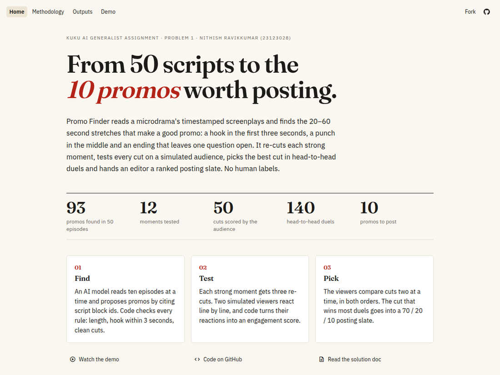

# Promo Finder

<h2 align="center">
  <a href="https://promo-finder-nrk.streamlit.app/"> -> Deployed webapp and demo </a>
</h1>


<p align="center">
  <a href="https://promo-finder-nrk.streamlit.app/">
    
  </a>
</p>

<p align="center">
  <a href="https://promo-finder-nrk.streamlit.app/">
    
  </a>
</p>

---

Reads a folder of timestamped microdrama screenplays and returns ranked 20–60 s promo clips for TikTok, Reels and
Shorts. For each clip you get the episode and exact start/end of every segment, the hook, the cliffhanger, and why it works.

**Showcase site:** [promo-finder-nrk.streamlit.app](https://promo-finder-nrk.streamlit.app/) (code in
[`showcase/`](showcase/README.md); run it locally from this folder with
`env -u PYTHONPATH uv run --project v2 streamlit run showcase/streamlit_app.py`). **v2** (engagement tournament with
head-to-head duels) is in [`v2/`](v2/README.md); its submitted run's files are in
[`v2/results/155bsnqx/`](v2/results/155bsnqx/).

## Quick start

Needs Python 3.12 via [uv](https://docs.astral.sh/uv/), and for the default backend the
[Codex CLI](https://github.com/openai/codex) on `PATH`.

```bash
uv sync
cp .env.example .env          # add your AgentRouter key (Codex backend) or any OpenAI-compatible API
uv run promo-finder run --input "/path/to/show-folder"
```

Outputs go to `outputs/<show>/<run_id>/`:

| File | What it is |
|---|---|
| `report.md` | ranked promos with hook, cliffhanger, why, cold-viewer read and transcript |
| `promos.csv` / `promos.json` | the same, for editors and tools |
| `rejected.json` | candidates that broke a rule, with the reason |
| `raw_llm.jsonl` | every raw model reply, unedited |
| `run_meta.json` | config, counts, tokens, cost, W&B link |

Useful flags: `--max-episodes 5` (quick try), `--per-call 1` (finer picks, more calls),
`--judge-top 0` (no judge), `--tag dev`. Score a run against your own labels: `uv run promo-finder eval --run <run folder>`.
Review app: `uv run streamlit run app.py`.

## Swapping the model

Swapping is a `.env` change; no code changes. There are two backends:

| `LLM_BACKEND` | When | Example settings |
|---|---|---|
| `codex` (default) | gateways that only accept approved agent clients, e.g. AgentRouter | `LLM_BASE_URL=https://agentrouter.org/v1`, `LLM_MODEL=gpt-5.6-sol` |
| `openai` | any OpenAI-compatible API, e.g. one Kuku provides, or Mistral, DeepSeek, Groq, Gemini, OpenRouter | `LLM_BASE_URL=https://api.example.com/v1`, `LLM_MODEL=...`, `LLM_JSON_MODE=1` |

The `codex` backend runs the real Codex CLI (`codex exec`) once per call: read-only, in an empty temp folder, with its own
`CODEX_HOME` under `.cache/`, so your `~/.codex` settings are not used. Codex adds ~17K tokens of its own instructions to
every call, which is why the default batches 5 episodes per call. For high volume, use the `openai` backend against a
direct API.

The cold-viewer judge uses `JUDGE_*` variables, which fall back to `LLM_*`. A different judge model reduces self-preference.

## How it works

```
parser (code) → finder (LLM, 5 episodes/call) → validator (code) → scorer + dedupe (code)
             → cold-viewer judge (LLM) → ranker (code) → outputs + W&B run → editor review (human)
```

| Module | Responsibility |
|---|---|
| `parser.py` | screenplay `.txt` → episodes of timed blocks; tolerant of header case changes |
| `transcript.py` | block ids (`E03L045`) and the text the models and reports see |
| `llm.py` | model client: picks the backend; JSON extraction, feedback retries, disk cache, token/cost accounting |
| `codex_client.py` | Codex CLI backend (`codex exec`), shaped like the OpenAI client so the rest doesn't care |
| `prompts.py` | finder and judge prompts; `PROMPT_VERSION` is logged with every run |
| `finder.py` | batches episodes and collects candidates |
| `validate.py` | turns ids into exact times and enforces the promo rules (below) |
| `rank.py` | rule score, dedupe, cold-viewer judge, final rank |
| `report.py`, `tracking.py`, `pipeline.py`, `cli.py`, `evaluate.py`, `app.py` | outputs, W&B, one shared run, CLI, eval, UI |

### Rules enforced in code (`validate.py`)

20–60 s total. The hook block starts ≤ 3 s into the promo; a late hook moves the start. At most 2 s plays after the
cliffhanger; a longer tail is trimmed. No line of dialogue is cut mid-sentence; boundaries widen to the whole line.
1–3 segments that don't overlap. Anything else is rejected with a reason code and listed in `rejected.json`.

### Design decisions

- **The model cites block ids, never timestamps.** Models misquote times. With ids, every cut lands on a real block
  edge and the rules can check it.
- **Five episodes per call.** Codex adds ~17K tokens to every call (~6.8¢ measured), so 10 finder calls + 1 judge call
  per show keep a full run at about $1.5–2. Promos can also join moments from neighbouring episodes.
- **The real Codex CLI, not an imitation.** AgentRouter refuses requests that don't come from an approved agent client.
  The tool runs Codex itself rather than faking its identity, and the `openai` backend covers every normal API.
- **Rules in code, taste in the model.** Time arithmetic and hard constraints are deterministic and tested; the model
  only judges drama.
- **A separate cold-viewer judge.** It sees only the clip, with no show context, which is how a scrolling viewer meets
  an ad. It tests "makes sense on its own" more directly than the finder's self-scores.
- **Ranking:** `0.4·hook + 0.3·cliffhanger + 0.3·standalone − spoiler penalty + 0.25 if episode ≤ 10`, plus the judge's
  1–5 score. The hook weighs most because an ad that doesn't stop the scroll is never watched. Early episodes get a
  small bonus because an ad should drop a new viewer at the start of the show.
- **Cache.** Raw replies are cached by (model, prompt), so reruns cost nothing and a crashed run resumes.


## Data

The input pack is confidential and is not in this repo. Point `--input` at your local copy. Tests use invented
fixtures in `tests/fixtures/`.
