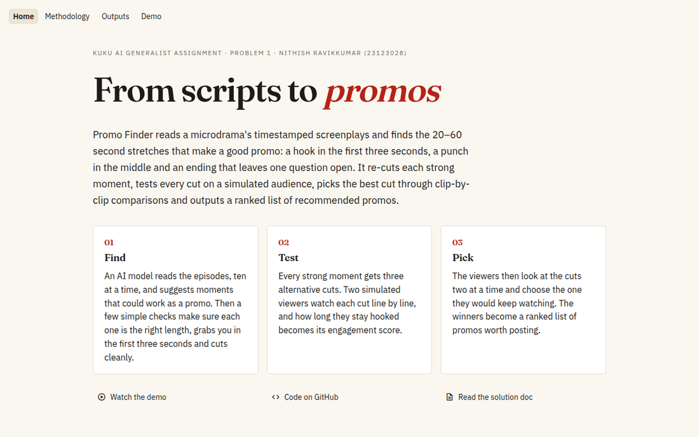
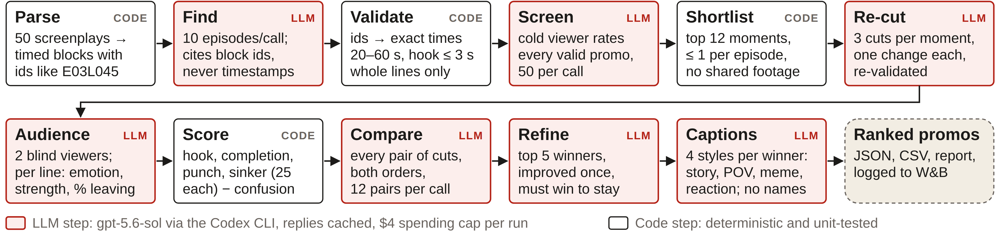

# Promo Finder

<h2 align="center">
  <a href="https://promo-finder-nrk.streamlit.app/"> -> Deployed webapp and demo </a>
</h1>


<p align="center">
  <a href="https://promo-finder-nrk.streamlit.app/">
    
  </a>
</p>

<p align="center">
  <a href="https://promo-finder-nrk.streamlit.app/">
    
  </a>
</p>

---

<p align="center">
  <b><a href="https://github.com/shadowPunch/promo-finder/blob/main/Nithish_Ravikkumar_23123028_Kuku_Problem1_solution.pdf">Solution doc (PDF)</a></b> &nbsp;·&nbsp;
  <b><a href="https://promo-finder-nrk.streamlit.app/">Live demo</a></b> &nbsp;·&nbsp;
  <b><a href="https://github.com/shadowPunch/promo-finder/tree/main/results/155bsnqx">Raw outputs</a></b>
</p>

Reads a folder of timestamped microdrama screenplays and recommends ranked 20–60 s promo clips for TikTok, Reels and
Shorts. It finds promo moments, re-cuts the best ones into several versions, scores every version with a simulated
audience, picks each moment's best cut in one-on-one comparisons and outputs a ranked list. For each promo you get the
episode and exact start and end of every segment, the hook, the cliffhanger and why it works.

The [showcase site](https://promo-finder-nrk.streamlit.app/) explains the method and replays a real run as an
animation (code in [`showcase/`](showcase/README.md)). The submitted run's outputs are in
[`results/155bsnqx/`](results/155bsnqx/).

## Running code

Needs Python 3.12 via [uv](https://docs.astral.sh/uv/), and for the default backend the
[Codex CLI](https://github.com/openai/codex) on `PATH`.

```bash
uv sync
cp .env.example .env              # add your model key (see "Model call and Swapping")
uv run promo-finder run --input "/path/to/show-scripts" --max-cost 5
uv run promo-finder captions --run outputs/<show>/<run_id> --input "/path/to/show-scripts"   # captions for an older run
uv run pytest                     # fake models: no network, no cost
uv run streamlit run app.py       # optional review app
uv run streamlit run showcase/streamlit_app.py   # the showcase site, locally
```

## Working

The full write-up (problem, assumptions, pipeline, results, evaluation and limitations) is in the
**[solution document](Nithish_Ravikkumar_23123028_Kuku_Problem1_solution.pdf)**. In brief:

<p align="center">
  
</p>

The model reads the screenplays and proposes promos that point at script lines, never timestamps; code turns those
lines into exact times and enforces the promo rules (20–60 s, hook within 3 s, ending on the cliffhanger). The 12
strongest moments get three re-cuts each, two simulated viewers react to every cut line by line, and each moment's
best cut is picked in one-on-one comparisons judged in both orders. The winners are ranked by engagement score into
the list of recommended promos, which an editor approves.

Each winner also gets four on-screen captions, written in the styles real microdrama reels use: a story hook ("Five
years after the divorce, he finally found out he had a child."), a "you"/POV question, a self-aware meme and a
reaction. Code rejects any caption that is too long or uses a character's name, since viewers don't know the names
yet. On the submitted run, "She Is to Be Executed" became *"Declared dead, the Duke has two days to stop his wife's
execution."*

On the 50-episode pack: 93 promos proposed, 92 passed the rules, and 12 moments were tested in 50 cuts with 140
one-on-one comparisons. A re-cut beat the original in 7 of the 12 moments, mostly through a stronger opening. The
comparisons are far steadier than single scores: the two orders agree on 86% of picks, against 61% when the same
cuts are simply scored twice.

## Engagement score

Per viewer, 0–100: 25 × hook (share still watching at 3 s) + 25 × completion (share still watching at the end)
+ 25 × punch (peak of the strongest engine, with small bonuses for an early surprise and for emotions that rise and
fall) + 25 × cliffhanger pull (need-to-know-next × spread of the imagined next scenes) − up to 15 for confusion.
Engagement = 0.65 × viewer A (women 18–30 who like romance and revenge drama) + 0.35 × viewer B (newcomers).
The weights are a stated assumption; every component is saved so they can be fitted to real hook rate and completion.

## Model call and Swapping

Swapping is a `.env` change. `JUDGE_*` variables set the model for the
quick screen and the audience, so a different model can score what the first one wrote.

| `LLM_BACKEND` | When | Example settings |
|---|---|---|
| `codex` (default) | gateways that only accept approved agent clients, e.g. AgentRouter | `LLM_BASE_URL=https://agentrouter.org/v1`, `LLM_MODEL=gpt-5.6-sol` |
| `openai` | any OpenAI-compatible API (OpenAI, Gemini, Groq, DeepSeek, OpenRouter, or one Kuku provides) | `LLM_BASE_URL=https://api.example.com/v1`, `LLM_MODEL=...`, `LLM_JSON_MODE=1` |

The `codex` backend runs the real Codex CLI (`codex exec`) once per call: read-only, in an empty temp folder, with its
own `CODEX_HOME` under `.cache/`, so your `~/.codex` settings are not used. Codex adds about 17K tokens of its own
instructions to every call; for high volume, use the `openai` backend against a direct API. Replies are cached in
`.cache/llm` by model and prompt, so reruns cost nothing and a crashed run resumes.

## Settings

| Flag | Default | What it does |
|---|---|---|
| `--per-call` | 5 | episodes per finder call (the submitted run used 10) |
| `--screen-batch` | 30 | promos per quick-screen call (the submitted run used 50) |
| `--shortlist` | 12 | moments that get new versions |
| `--versions` | 3 | new versions per moment |
| `--refine-top` | 5 | winners that get one improvement round (0 = off) |
| `--reliability` | 8 | winners re-scored to measure stability (0 = off) |
| `--no-duels` | | pick winners by score instead of one-on-one comparisons |
| `--duel-batch` | 12 | comparisons per audience call |
| `--audience-weight` | 0.65 | weight of viewer A |
| `--max-cost` | 5 | spending cap in USD (0 = none); the run stops cleanly and is tagged `partial` |
| `--max-episodes` | all | quick dev runs on the first N episodes |
| `--no-captions` | | skip the captions for the winners |
| `--tag` | | W&B tag, repeatable |


## Outputs

`outputs/<show>/<run_id>/`: `report.md` (the ranked list first, then each winner with its score parts, drop-off
sparklines, AIDA timeline, versions tried with their comparison win shares, captions and transcript), `promos.json/csv`
(winners, with their captions), `versions.json` (every version with per-second curves, and every comparison with both picks and the reason),
`screened.json`, `rejected.json`, `raw_llm.jsonl`, `run_meta.json`.

The submitted run's shareable files (no scripts, no raw model log) are in `results/155bsnqx/`; its `captions.json` was
written afterwards by `promo-finder captions`, which adds captions to a finished run without changing anything else. To refresh the
showcase site's data from a run, see [`showcase/README.md`](showcase/README.md). The demo uses an artificial show in
`examples/demo-show/`.

Every run is also logged to Weights & Biases (project `kuku-promo-finder`; `PROMO_WANDB=0` turns it off), and screenplay text is never sent there.

## Business frameworks employed

- AIDA (the four score parts)
- North Star metric (one engagement score whose parts map to platform metrics)
  
## Data

The input pack is confidential and is not in this repo. Point `--input` at your local copy. Tests use invented
fixtures in `tests/fixtures/`.
